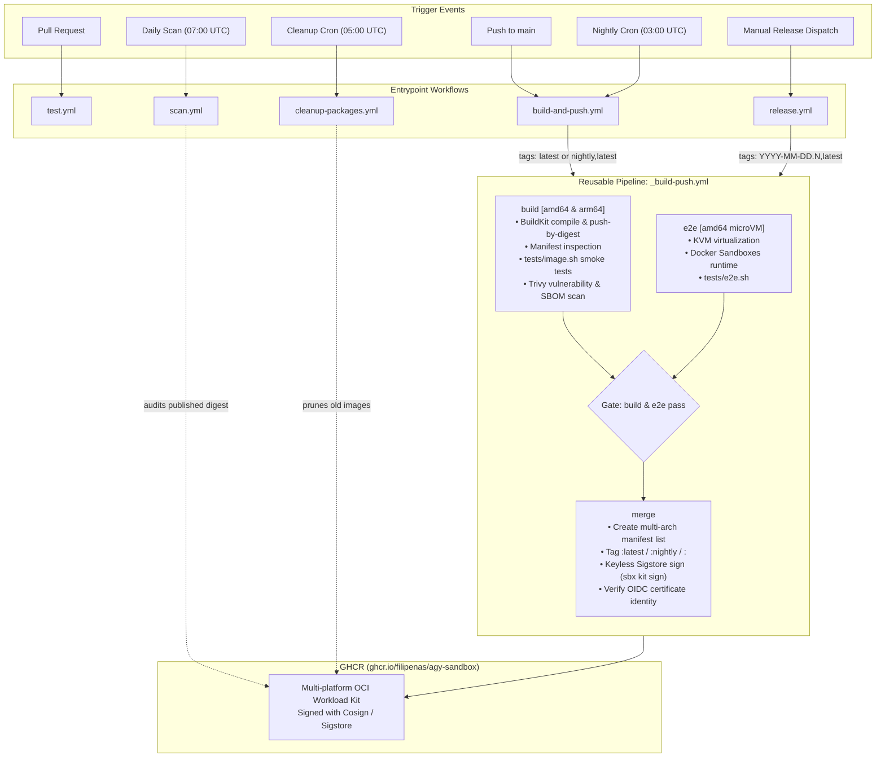
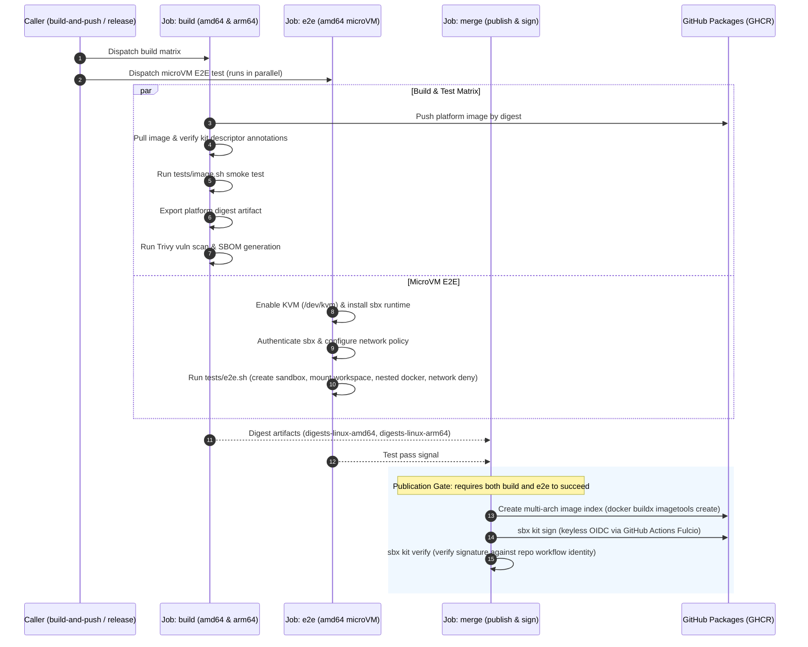

# CI/CD Workflows

This directory contains the GitHub Actions workflows that test, build, publish, sign, and scan the `agy-sandbox` workload kit.

## Architecture Overview

The CI/CD pipeline uses an isolated, layered architecture:
- **`test.yml`**: Fast offline image validation on PRs without registry access.
- **`build-and-push.yml`**: Triggers publishing of `:latest` (on `main`) and `:nightly` (cron).
- **`release.yml`**: Triggers dated release versions (`YYYY-MM-DD.<counter>`), publishes, and creates GitHub Releases.
- **`_build-push.yml`**: Reusable core workflow that builds multi-arch images, runs microVM E2E tests in parallel, gates publication on both passing, and signs the kit with Sigstore via `sbx`.
- **`scan.yml`**: Scheduled daily dependency vulnerability and SBOM audit of the published `:latest` image.
- **`cleanup-packages.yml`**: Scheduled daily pruning of old GHCR images (keeps the 2 newest images, `:latest`, and the two latest date release versions).



---

## Workflows Reference

| Workflow | File | Trigger | Runs E2E? | Publishes to GHCR? | Description |
|---|---|---|---|---|---|
| **Test** | [`test.yml`](test.yml) | `pull_request` (image/test paths), `workflow_dispatch` | No | No | Builds native `amd64` and `arm64` images locally (`load: true`), hits warm cache from `main`, and runs offline smoke tests (`tests/image.sh`). Skips CI/docs-only PRs. |
| **Build and Push** | [`build-and-push.yml`](build-and-push.yml) | `push` (`main`), cron (`0 3 * * *`), `workflow_dispatch` | Yes | Yes (`:latest`, `:nightly`) | Calls `_build-push.yml` to publish `:latest` on main pushes, or `:nightly,latest` on scheduled runs (`Nightly Run`). |
| **Release** | [`release.yml`](release.yml) | `workflow_dispatch` (on `main`) | Yes | Yes (`:<version>,latest`) | Computes `<UTC date>.<counter>`, publishes via `_build-push.yml`, and creates a GitHub Release and git tag. |
| **Build, Test and Sign** | [`_build-push.yml`](_build-push.yml) | `workflow_call` (reusable) | Yes | Yes (custom tags) | The core build pipeline. Builds native images, runs microVM E2E tests concurrently, gates publishing, and signs with Sigstore. |
| **Cleanup Packages** | [`cleanup-packages.yml`](cleanup-packages.yml) | cron (`0 5 * * *`), `workflow_dispatch` | No | No (deletes old) | Prunes old GHCR container packages at 05:00 UTC, preserving the 2 newest images, `:latest`, and the two latest date release versions. |
| **Dependency Scan** | [`scan.yml`](scan.yml) | cron (`0 7 * * *`), `workflow_dispatch` | No | No | Resolves published `:latest` digest, runs Trivy vulnerability + CycloneDX SBOM scans, renders a Markdown table in the Actions summary, uploads SARIF to GitHub Security, and retains artifacts for 7 days. |

---

## Reusable Publishing Pipeline (`_build-push.yml`)

The `_build-push.yml` workflow enforces that **no image or tag is published unless both container tests and microVM E2E tests succeed**.



### Key Highlights

1. **Parallel Execution for Speed**:
   - Multi-arch native builds (`linux/amd64` on `ubuntu-24.04`, `linux/arm64` on `ubuntu-24.04-arm`) and microVM E2E testing run concurrently.
   - E2E testing does not block the build matrix from compiling and testing native images.

2. **Strict Publication Gate**:
   - The `merge` job depends on both `[build, e2e]`.
   - If `tests/image.sh` fails on either architecture OR `tests/e2e.sh` fails in the microVM, the pipeline aborts immediately before any tags (`:latest`, `:nightly`, or release versions) are created in GHCR.

3. **Keyless Sigstore Signing**:
   - `merge` calls `sbx kit sign` using GitHub Actions OIDC (`id-token: write`).
   - Signatures are signed under the certificate identity:
     ```text
     https://github.com/filipenas/agy-sandbox/.github/workflows/_build-push.yml@<ref>
     ```
   - Every build immediately verifies the newly published signatures using `sbx kit verify`.

4. **Warm Cache Sharing**:
   - Both `test.yml` and `_build-push.yml` use unified cache scopes (`linux-amd64` and `linux-arm64`).
   - PR builds in `test.yml` automatically leverage the layer caches produced by `main`, reducing build times from 15+ minutes to 1–2 minutes.

